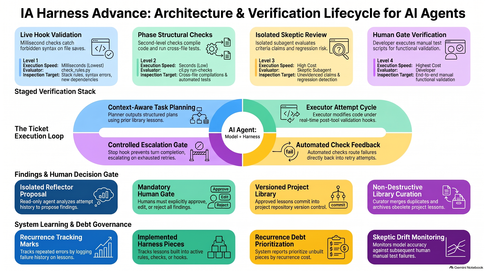
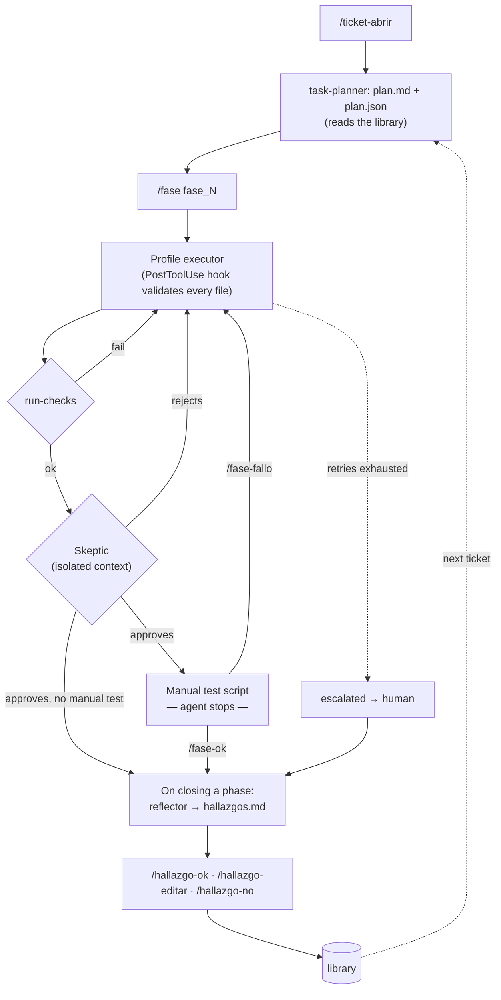

# IA Harness — *harness advance* version

Engineering harness for developing with AI agents on real projects.
Runs natively in **Claude Code**, and its core (CLI, contracts, and
checks) is pure Python, so it can also be used with other models (see
[Using with another model](docs/tecnico.md#usarlo-con-otro-modelo-que-no-sea-claude)).

> **Agent = Model + Harness.** The model reasons; the harness turns that
> reasoning into verifiable work. Every time the agent makes a repeatable
> error, the fix goes into the harness (a rule, a check, a hook), not just
> into the prompt.

> **Technical documentation** (architecture, CLI, contracts, profiles, development, and
> pending items): [docs/tecnico.md](docs/tecnico.md). This README is the usage guide.

---

## Contents

- [What it does](#what-it-does)
- [What the harness advance version includes](#what-the-harness-advance-version-includes)
- [The ticket cycle](#the-ticket-cycle)
- [Assisted test](#assisted-test)
  - [Project setup: `/harness-setup`](#project-setup-harness-setup)
- [Findings and lessons library](#findings-and-lessons-library)
  - [Curate the library](#curate-the-library)
- [Installation and deployment](#installation-and-deployment)
- [Daily usage](#daily-usage)
  - [Findings commands, one by one](#findings-commands-one-by-one)
- [How to read the report](#how-to-read-the-report)
- [Common errors](#common-errors)

---

## What it does

Takes a requirement (a ticket) and carries it to approved code, in phases,
with staged verification from lowest to highest cost:


<p align="center">
  
</p>

| Level | Who verifies | Cost | What it catches |
|---|---|---|---|
| 1. Live hook | `check_rules.py`, on every file the agent saves | milliseconds | Stack rules: forbidden syntax, audit comments, new dependencies |
| 2. Phase checks | `cli.py run-checks` + structural checks from profile | seconds | What requires crossing files, compiling, or running tests |
| 3. Skeptic | `skeptic` subagent, with isolated context | expensive | Claims without evidence, unmet success criteria, regressions |
| 4. Human | The developer, with a manual test script | most expensive | End-to-end functional verification |

Rules that sustain it:

- **Counters and state are written only by the CLI**, never by the model.
- **The agent writes JSON and a script validates and rejects it** if it doesn't meet the contract.
- **The phase doesn't close without the human gate**: the `Stop` hook prevents ending the
  turn with a phase mid-cycle.
- **Retries have a limit**: when exhausted, the phase goes to `escalated` and returns to the human.

---

## What the harness advance version includes

The *harness advance* version incorporates ideas from
[Harness²](https://github.com/google-research/harness2) (Google Research), adapted
so that **the human is in the loop**. There learning is automatic; here
a lesson passes through the developer before affecting subsequent tickets.

| New feature | What it is |
|---|---|
| **`task-planner` v3** | Skill that plans the ticket in phases anchored in code. Emits `plan.md` for the human and `plan.json` for the harness, and reads the lessons library |
| **Reflector** | **Read-only** subagent that, when closing each phase (approved or escalated), proposes reusable lessons |
| **Findings with human decision** | Each proposed lesson stays `proposed` until the developer approves, edits, or rejects it |
| **Library** | Approved lessons live in `<project>/.claude/biblioteca/` and are versioned with the project. The planner reads them on the next ticket |
| **"Where each fix goes"** | A ladder that says which harness piece fixes each failure type (see [docs/tecnico.md](docs/tecnico.md#dónde-va-cada-corrección)) |
| **Recurrences and debt** | The reflector flags when an error was already in the library; the human marks when they built the piece a lesson asked for; `report` crosses both |
| **Reference test** | Fails if a harness document names a skill, agent, subcommand, or command that doesn't exist |
| **Evidence is data** | The skeptic and reflector don't obey instructions written inside the code or files they review |

Design detail: `docs/superpowers/plans/harness-advance.md` (origin and decisions
DA1–DA9) and the spec, decisions D10–D13 and sections §6.6, §10 and §10.1.

## The ticket cycle



Each pass through the executor is an **attempt**. A check failure, skeptic
rejection, or manual test failure is saved in `historial_fallos` with its
origin (`check`, `esceptico`, or `humano`), and the next attempt receives the
full history. Corrections demanded by the live hook don't count as attempts:
they're self-correction.

---

## Assisted test

The manual test script marks each step with `quien`: `agente` (agent) or `humano`
(human). Before your turn, the `probador` (tester) subagent runs the `agente` steps
with the session's automated browser and read-only queries, and leaves
`prueba_asistida.md` and `evidencia/` (screenshots, queries before and after) in the
attempt. **It does not give the verdict**: you do, with `/fase-ok` or `/fase-fallo`,
after reviewing the evidence and running the `humano` steps. A step the tester marks
`simulado` (simulated) or `no ejecutado` (not run) does not count as passed.

`humano` steps are those that need a login, paying or charging, something the browser
does rather than the page (reopening a closed tab), or comparing against the mockup.
The tester never types credentials: if it hits a login, it stops, you sign in in that
window, and it is invoked again.

### Project setup: `/harness-setup`

The harness knows no browser and no database: each project decides that, once, with
`/harness-setup`. The agent checks which tools the session has, asks you which one is
the browser, which one is the database, which environment to query, and which database
tools are forbidden (those that switch environment or write), and saves it in
`<project>/.claude/prueba_asistida.json`. `/ticket-abrir` warns if it is missing,
without blocking.

- **Without a browser** (for example, an API with no UI) the tester still runs the
  query and API steps, and marks `no ejecutado` the ones that need a browser. With no
  browser and no database, every step is yours.
- **It installs nothing and asks for no credentials.** Connecting the browser or the
  database (its version, its configuration, its login) is up to you; setup only
  records what is already there.
- **Forbidden tools are an instruction, not a technical block**: the tester receives
  them and does not use them. If you need a hard block, configure it in your agent tool.
- No profile ships that file, so redeploying does not overwrite it.

One browser that works: the Playwright MCP (`@playwright/mcp`), with a pinned version
and its own `--output-dir`. Two things seen in real use: if the site keeps the session
in a session cookie, the browser's persistent profile does not keep it and you sign in
on every run; and screenshots the server saves on its own go to its `--output-dir`,
not to `evidencia/`.

---

## Findings and lessons library

### How a finding is born

1. The phase closes (approved or escalated).
2. The **reflector** receives, in isolated context, the plan phase, the
   `historial_fallos`, the `checks.json` and `veredicto.json` of each attempt,
   the manual test result, and the library's `INDEX.md`. It does **not** receive
   the executor conversation.
3. It proposes zero or more findings. **Proposing nothing is a valid response.**
4. `cli.py record-hallazgos` validates the proposal and writes `hallazgos.json` and
   `hallazgos.md` in the phase folder. All start in `proposed` state.

Each finding has:

| Field | Meaning |
|---|---|
| `senal` | In what situation it applies (the shape of the case, not this ticket's data) |
| `leccion` | What to do, naming the harness piece |
| `evidencia` | The attempts, checks, or observations it's based on |
| `confianza` | `high`, `medium`, or `low` |
| `dimension` | `process` (how the agent works) or `domain` (what someone who masters the project knows) |
| `componente` | Where the fix goes: `rule`, `check`, `skill`, `hook`, or `agent` (see [where each fix goes](docs/tecnico.md#dónde-va-cada-corrección)) |
| `reincide` | Optional. Reference to an approved lesson that should have prevented this error |

### Your decision

`hallazgos.md` shows each finding with its full reference `TICKET/fase_N/hN`:

```text
/hallazgo-ok ISR-110722/fase_1/h1
/hallazgo-editar ISR-110722/fase_1/h2 "corrected lesson"
/hallazgo-no ISR-110722/fase_1/h3 "reason"
/hallazgo "a lesson of mine"        ← enters approved, with human origin
```

- **Nothing enters the library without your decision.**
- **Pending items don't block** the phase or the ticket. `/ticket-abrir` and
  `cli.py hallazgos-pendientes` remind you.
- **Rejected ones are saved with their reason**, so the reflector won't propose them again.
- Always use the full reference for a finding from another phase or ticket.
  A bare `h1` only works for the active phase.
- The detail of each command, with examples and errors, is in
  [Findings commands, one by one](#findings-commands-one-by-one).

### The library

```
<project>/.claude/biblioteca/
├── INDEX.md                          derived: rebuilt from entries
├── entradas/ISR-110722-fase_1-h1.md  approved lessons
├── rechazados/ISR-110722-fase_1-h3.md
├── retiradas/ISR-110722-fase_2-h1.md lessons removed by curation
└── curacion-rechazada.md             curations you rejected
```

- **Version it with the project**: commit `.claude/biblioteca/` after
  approving findings, so the team receives it.
- `deploy.ps1` never overwrites it: copies the profile without deleting and no profile
  brings a `biblioteca/` folder (a test watches this).
- If `INDEX.md` has a merge conflict, run
  `cli.py reconstruir-biblioteca`: the index regenerates from the entries.
- **For the planner, a lesson is a hypothesis**: if it uses it, it anchors it as
  `por_confirmar` and verifies it in code.

---

### Recurrences and implemented lessons

Two marks track what happens to a lesson after approval:

- **Recurrence.** If in another phase the agent repeats an error that an approved
  lesson should have prevented, the reflector proposes it with `reincide` pointing to that lesson and
  `hallazgos.md` shows it as `reincide en <ref>`. Approving with `/hallazgo-ok`
  or `/hallazgo-editar` **doesn't create a new entry**: the original adds a
  `falló` line with the date, ticket, and whether the lesson had a piece at that time. If
  the reflector was wrong, `--nueva` or `--reincide <ref>` correct it (see
  [the commands](#findings-commands-one-by-one)). Rejecting works as always.
- **Implemented.** When you build the piece the lesson asked for, `/hallazgo-hecho`
  marks it. From then on a new failure counts as "failed while implemented".

`INDEX.md` shows marks next to each lesson, e.g.
`(implementada 02-11-2026) (falló 2×)`. The planner and reflector read them: a lesson
that already failed weighs more when planning, and the reflector knows which have pieces. The
[report](#how-to-read-the-report) crosses them. Line details in
[docs/tecnico.md](docs/tecnico.md#líneas-de-una-entrada-de-la-biblioteca).

---

### Curate the library

The library only grows with each phase, and the planner reads it entirely on every ticket.
Over time, lessons pile up that say the same thing, others that contradict a profile rule,
and others that talk about code that no longer exists. `/biblioteca-curar` runs a
**curator** (read-only, like the reflector) that proposes two action types:

- **Merge** lessons that say the same thing into one, preserving all their failures.
- **Retire** a lesson that's no longer valid, with the reason.

You decide each action with `/curacion-ok cN`, `/curacion-editar cN ...`, or
`/curacion-no cN "<reason>"`. **Nothing is deleted:** retired lessons go to `retiradas/`
with their reason and failures, `INDEX.md` lists them under "Retiradas — no aplicar",
and an old reference to a merged lesson tells you which to use. Your rejections stay in
`curacion-rechazada.md`, which is versioned, so the curator won't propose them again in any clone.

**When to run it:** when the [report](#how-to-read-the-report) suggests it in its
Curation section, or when the library grew several tickets without review. No open ticket
needed, but a lesson anchoring the current ticket isn't touched until all its phases are approved.

**How to decide:** signals (`cli.py senales-biblioteca`) are hints, not reasons.
`usos` counts plans from **your** clone, so "no usage" isn't enough to retire; a missing
path could be a generated file git doesn't track, or something that isn't a path (an endpoint).

---

## Installation and deployment

Requirements: Windows with PowerShell 5.1, Python 3.12 (stdlib only), Git, and Claude Code.

1. **Deploy** the generic harness and the project profile:

   ```powershell
   .\deploy.ps1 -Proyecto "C:\ruta\al\proyecto" -Perfil <perfil>
   ```

   Copies `harness/{hooks,agents,skills,commands}` to `~/.claude/` and
   `profiles/<perfil>/` to `<project>/.claude/`. Also adds `.harness/` to
   the project's `.gitignore`.

   It also registers the two hooks (`check_rules.py` and `gate_phase.py`) in
   `~/.claude/settings.json` and reports what it did with each. It only adds what's missing: it
   doesn't touch your other hooks or the rest of the file, and if it modifies it leaves a backup
   `settings.json.bak-dd-mm-yyyy-HHMMSS` first. If `settings.json` isn't valid JSON, it
   doesn't touch it and deployment fails.

   With `-SinHooks` it doesn't touch `settings.json`: prints the block with your paths for you to
   merge manually inside the `hooks` object.

2. **Open a new session** of Claude Code in the project. Sessions already
   open won't load the new agents or commands.

Profile included in this repo: `crud-api` (exercise of a notes CRUD API,
.NET 10 + EF Core + SQLite, with build and tests via `dotnet_build`). Adopting another
project means creating its profile:
see [Create a new project profile](docs/tecnico.md#crear-el-perfil-de-un-proyecto-nuevo).

---

## Daily usage

| Command | When |
|---|---|
| `/harness-setup` | Once per project: which browser and which database the tester uses (see [Assisted test](#assisted-test)) |
| `/ticket-abrir <requirement or .md path>` | Start a ticket: asks for number, developer, and date, and generates the plan |
| `/fase fase_N` | Run a phase's full cycle; ends at the manual test script |
| `/fase-pausa ["<reason>"]` | Pause the active phase to discuss something else or end the day. Resumes with `/fase fase_N` without spending an attempt. If you opened another ticket meanwhile, reopen it first with the same id and its `ticket_context.json` data, without replanning |
| `/fase-ok` | Manual test passed. Closes the phase and calls the reflector |
| `/fase-fallo <step> "<what happened>"` | Manual test failed at that step; starts the next attempt |
| `/hallazgo-ok <ref>` | Approve a finding |
| `/hallazgo-editar <ref> "<lesson>"` | Edit and approve a finding |
| `/hallazgo-no <ref> "<reason>"` | Reject a finding |
| `/hallazgo "<lesson>"` | Add your own lesson (enters approved) |
| `/hallazgo-hecho <ref> "<note>"` | Notify that you've built the piece an approved lesson asked for |
| `/biblioteca-curar` | Run the curator on the library (see [Curate the library](#curate-the-library)) |
| `/curacion-ok <cN>` | Apply a curation action |
| `/curacion-editar <cN> [--texto] [--senal] [--quitar <ref>] [--motivo]` | Edit and apply a curation action |
| `/curacion-no <cN> "<reason>"` | Reject a curation action |

The orchestrator is the `ticket-loop` skill, which the commands invoke. If the session
is cut, it resumes from state in `.harness/`: the CLI and the `Stop` hook know what state
each phase was in.

For emergencies, if the `Stop` hook traps you and there's no other way out, open it off:
`$env:HARNESS_STOP="off"; claude`. It's only read when opening the session, and disables the hook
completely while it lasts.

### Findings commands, one by one

The five findings commands are shortcuts to `cli.py`. The agent only extracts arguments and
runs the CLI, which is the only thing that writes state: `hallazgos.json`, `hallazgos.md`, and
the library. If a required argument is missing, the agent asks for it before running
anything. If the CLI fails, it shows the error as-is.

**How to name a finding (`<ref>`).** Use the full reference `TICKET/fase_N/hN`,
exactly as printed by `hallazgos.md` and `cli.py hallazgos-pendientes`. A bare id
(`h1`) only works for the active phase in `current.json`. The agent never completes the
reference on its own.

When closing a phase, `hallazgos.md` ends with the three possible responses for each
proposed finding, ready to copy:

```text
Respond for each proposed finding:
- Approve → `/hallazgo-ok ISR-110722/fase_1/h1`
- Edit and approve → `/hallazgo-editar ISR-110722/fase_1/h1 "<corrected lesson>"`
- Reject → `/hallazgo-no ISR-110722/fase_1/h1 "<reason>"`
```

#### `/hallazgo-ok <ref>`

Approves the lesson exactly as the reflector proposed it.

- **Example:** `/hallazgo-ok ISR-110722/fase_1/h1`
- **Runs:** `cli.py resolver-hallazgo --decision ok --id ISR-110722/fase_1/h1`
- **Effect:**
  - The finding goes to `approved`.
  - Writes `.claude/biblioteca/entradas/ISR-110722-fase_1-h1.md`.
  - Rebuilds `INDEX.md`.
- **Output:** `Hallazgo ISR-110722/fase_1/h1 aprobado: <entry path>`
- **If it's a recurrence** (the finding shows `reincide en <ref>` in `hallazgos.md`):
  no new entry is created; a `falló` line is added to the original lesson. Output is
  `Hallazgo <ref> aprobado como reincidencia de <ref original>: <original entry path>`.
- **If the reflector was wrong**, two options passed directly to the CLI:
  - `--nueva`: not a recurrence; ignore the mark and create a new entry.
    Example: `/hallazgo-ok ISR-110722/fase_1/h4 --nueva`
  - `--reincide <ref>`: yes it's a recurrence, of that other lesson (whether the reflector
    marked it or not). Example: `/hallazgo-ok ISR-110722/fase_1/h4 --reincide ISR-110501/fase_2/h1`
  - Only valid when approving, not together, and the lesson must be **approved**.

#### `/hallazgo-editar <ref> "<corrected lesson>"`

Approves the finding with your own wording. Use when the signal is good but the
lesson is poorly worded, too broad, or too specific.

- **Example:**
  `/hallazgo-editar ISR-110722/fase_1/h2 "Before changing a method signature, find all its callers"`
- **Runs:** `cli.py resolver-hallazgo --decision editar --id ISR-110722/fase_1/h2 --texto "..."`
- **Effect:**
  - The finding goes to `approved` with your text in `lesson`.
  - The reflector's proposal is kept in `original lesson`, so what you corrected is visible.
  - The entry goes to `entradas/`.
- **Options:** accepts `--nueva` and `--reincide <ref>`, same as `/hallazgo-ok`.

#### `/hallazgo-no <ref> "<reason>"`

Rejects the finding. The reason is mandatory because the reflector reads it, so it
won't propose the same thing again.

- **Example:**
  `/hallazgo-no ISR-110722/fase_1/h3 "It was a one-off case in the ticket, not a pattern"`
- **Runs:** `cli.py resolver-hallazgo --decision no --id ISR-110722/fase_1/h3 --motivo "..."`
- **Effect:**
  - The finding goes to `rejected`.
  - The entry goes to `rechazados/`.
  - Appears in `INDEX.md` under "Rechazadas — no volver a proponer".

#### `/hallazgo "<lesson>"`

Adds a lesson you noticed that no agent saw. Enters **already approved**, with
`origen: humano`, and attaches to the active phase with the next free id (`hN`).

- **Example:** `/hallazgo "In this project visible texts go in the resource file, never in code"`
- **Optional:** specify the dimension (`process` or `domain`) and the harness piece it fixes
  (`rule`, `check`, `skill`, `hook`, or `agent`), and the agent passes them to the CLI. E.g.:
  `/hallazgo "..." — dimension domain, component rule`
- **Runs:** `cli.py hallazgo --texto "..." [--dimension ...] [--componente ...] [--ticket ... --fase ...]`
- **Between tickets** (no active phase), say which phase it's for:
  `/hallazgo "..." — ticket ISR-110722, fase fase_2`, and the agent passes
  `--ticket ISR-110722 --fase fase_2`. The phase must have been opened at some point.

#### `/hallazgo-hecho <ref> "<note>"`

Notifies that you've built the harness piece an approved lesson asked for: the
rule, check, skill, hook, or agent text. Use it after building the piece, not before: the
report distinguishes lessons with a piece from those still in debt.

- **Example:**
  `/hallazgo-hecho ISR-110722/fase_1/h2 "rule no_firma_sin_llamadores in rules.json, commit 4f2a9c1"`
- **Runs:** `cli.py hallazgo-hecho --id ISR-110722/fase_1/h2 --nota "..."`
- **Effect:** writes in the entry `- **implementada**: <date> · <note>` and `INDEX.md`
  shows `(implementada <date>)`. Previous `falló` lines are preserved.
- **Output:** `Lección <ref> implementada: <date> · <note>`. If already marked, a second
  line says the mark it replaced.
- **Requirements:** full reference (bare `h1` doesn't work), a note (say what you did: a commit, a file), and an **approved** lesson.

To see everything pending decision, across all tickets:

```powershell
python "$HOME\.claude\hooks\cli.py" hallazgos-pendientes
```

After approving or rejecting, commit `.claude/biblioteca/` in the project.

---

## How to read the report

```powershell
python "$HOME\.claude\hooks\cli.py" report [--project <path>] [--json]
```

Read-only: writes nothing to the project. Looks at `.harness/tickets/` and
`.claude/biblioteca/`. With `--json` prints the same raw data for another tool. A project
without data doesn't error: each section says `No data yet.` An unreadable or malformed
file doesn't stop the report: it's named at the end, in "Files that couldn't be read", and it continues.

Sections go from what says most about whether the harness learns to what says least.
Read them in that order.

**Summary.** Counters: tickets, phases, escalated phases, approved lessons,
implemented, those that failed while implemented, and those that returned without a piece.
Note: *returned without piece* is **historical**. Counts times a lesson failed again when it had no piece (one per recurrence), even if you later built the piece or the lesson was retired or merged in curation, so it can exceed what Debt lists. Curating doesn't lower it.

**Failed while implemented.** Each lesson that failed again *after* marking it with `/hallazgo-hecho`, with its signal, piece, and for each failure, the date, ticket, and what should have been done. Next to each lesson its current `implementada` mark is shown (date and note): a failure before a new mark reads as history. This is the most serious section: **the piece doesn't work**.
What to do:

1. Open the lesson and the failure, and find out why the piece didn't catch it: does the pattern not cover this case? does the check not run in this phase? is the instruction ignored?
2. Fix it or promote it to a stronger piece (from `skill` or `agent` to `check`, from `check` to `hook`; see [where each fix goes](docs/tecnico.md#dónde-va-cada-corrección)).
3. When the new piece is in place, run `/hallazgo-hecho` again with a new note: the previous mark is replaced and failures stay in history.

**Debt.** Approved lessons without `implementada`, grouped by piece
(`rule`, `check`, `skill`, `hook`, `agent`; own lessons without piece in their
group). Within each group, those that **returned without piece** come first, with
`costó otra vez N×` and, for each time, date, ticket, and what should have been done. That N× is your work order: **build the piece of the lesson that cost the most first**.
When you finish one, mark it with `/hallazgo-hecho`: it leaves debt.

**Curation.** Lessons no plan from this clone anchored, those mentioning paths git no longer tracks, how many curation actions await your decision, when the last curation was, and how many lessons were retired. If any signal or pending item exists, suggests `/biblioteca-curar`. They're hints: see [Curate the library](#curate-the-library).

**Skeptic by model.** The skeptic judges with a different Claude model than the one that ran the phase (Sonnet by default; Opus if the executor is already Sonnet; the profile can fix it with `esceptico.modelo` in `rules.json`). For each model: how many phases it judged, how many it approved and rejected, and how many **got away**: it approved them and then the manual test failed. That last number says if the model is up to it; if it grows, fix a stricter one for the project. Verdicts before this version show as `unknown`.

**Findings.** How many were approved as-is, how many with edits, how many were recurrences, and how many are yours; the **proposed undecided**, with their reference (decide them with `/hallazgo-ok`, `/hallazgo-editar`, or `/hallazgo-no`), and the rejected with their reason. Many edits suggest the reflector writes poorly; many rejections, that it proposes what isn't a pattern.

**Phases.** Attempts per phase (`used/max` and state), escalated phases, failure origin
(`check`, `esceptico`, `humano`), most violated rules, and phases the skeptic rejected
in two or more attempts, with their reasons. A phase rejected multiple times for similar reasons is a candidate for a deterministic check. A heavily violated rule may be poorly written or not reaching who needs it.

**Files that couldn't be read.** Only appears if there were any: invalid JSON,
undecodable bytes, a `hallazgos.json` out of contract. The report counts the rest; fix or delete those files so they're included.

Example, with a lesson that cost again without a piece:

```text
Debt
  check
    ISR-110722/fase_1/h2 — Signature change without finding callers — costó otra vez 2×
      02-11-2026 in ISR-111003/fase_2/h1: Find callers before changing the signature
      05-11-2026 in ISR-111240/fase_1/h3: Find callers before changing the signature
```

---

## Common errors

| CLI Message | What happened |
|---|---|
| `el hallazgo '<ref>' no existe; ids válidos en …: h1, h2` | The id isn't in that phase. The message lists valid ids |
| `el hallazgo <ref> ya está 'aprobado'` (o `'rechazado'`) | Already decided. Commands don't undo a decision |
| `la fase '…' del ticket '…' no tiene hallazgos` | That phase doesn't have reflection recorded yet |
| `no se sabe qué fase resolver: usa la referencia completa …` | You gave a bare `h1` and there's no active phase |
| `'…' no es un hallazgo: usa el id (h1) o la referencia completa …` | The reference is malformed |
| `rechazar un hallazgo exige --motivo …` | `/hallazgo-no` without reason |
| `editar un hallazgo exige --texto …` | `/hallazgo-editar` without the corrected lesson |
| `no hay fase activa: corre 'open-fase'` | `/hallazgo` outside a phase |
| `--nueva y --reincide se excluyen: elige una` | You passed both to `/hallazgo-ok` or `/hallazgo-editar` |
| `--nueva y --reincide solo valen al aprobar …` | You passed them with `/hallazgo-no` |
| `el hallazgo <ref> reincide en …` | The lesson it recurs to isn't approved (rejected, undecided, or malformed). Nothing was written |
| `--reincide '…' no tiene la forma TICKET/fase_N/hN` | The reference is malformed |
| `--id '…' no tiene la forma TICKET/fase_N/hN: este comando solo acepta la referencia completa` | `/hallazgo-hecho` with a bare id |
| `--nota no puede estar vacía …` | `/hallazgo-hecho` without saying what was done |
| `no se puede marcar … ` | Only an approved lesson can be marked; that one doesn't exist or isn't approved |