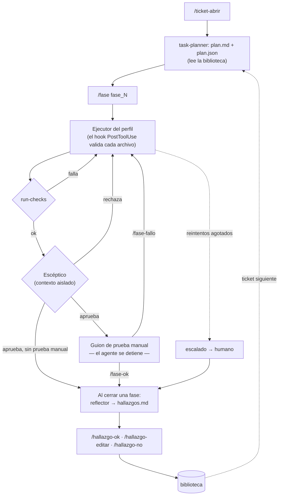

# IA Harness — versión *harness advance*

Harness de ingeniería para desarrollar con agentes de IA sobre proyectos reales de
Azzule. Corre de forma nativa en **Claude Code**, y su núcleo (CLI, contratos y
checks) es Python puro, así que también se puede usar con otros modelos (ver
[Usarlo con otro modelo](#usarlo-con-otro-modelo-que-no-sea-claude)).

> **Agente = Modelo + Harness.** El modelo razona; el harness convierte ese
> razonamiento en trabajo verificable. Cada vez que el agente comete un error
> repetible, la corrección va al harness (una regla, un check, un hook), no solo
> al prompt.

---

## Contenido

- [Qué hace](#qué-hace)
- [Qué trae la versión harness advance](#qué-trae-la-versión-harness-advance)
- [Arquitectura: tres planos](#arquitectura-tres-planos)
- [El ciclo de un ticket](#el-ciclo-de-un-ticket)
- [Hallazgos y biblioteca de lecciones](#hallazgos-y-biblioteca-de-lecciones)
- [Instalación y despliegue](#instalación-y-despliegue)
- [Uso diario](#uso-diario)
- [Referencia del CLI](#referencia-del-cli)
- [Estado en disco y contratos](#estado-en-disco-y-contratos)
- [Crear el perfil de un proyecto nuevo](#crear-el-perfil-de-un-proyecto-nuevo)
- [Usarlo con otro modelo que no sea Claude](#usarlo-con-otro-modelo-que-no-sea-claude)
- [Desarrollo del propio harness](#desarrollo-del-propio-harness)
- [Estructura del repositorio](#estructura-del-repositorio)

---

## Qué hace

Toma un requerimiento (un ticket) y lo lleva hasta código aprobado, en fases, con
verificación escalonada de menor a mayor costo:

| Nivel | Quién verifica | Costo | Qué atrapa |
|---|---|---|---|
| 1. Hook en vivo | `check_rules.py`, en cada archivo que el agente guarda | milisegundos | Reglas del stack: sintaxis prohibida, comentarios de auditoría, dependencias nuevas |
| 2. Checks de la fase | `cli.py run-checks` + checks estructurales del perfil | segundos | Lo que exige cruzar archivos, compilar o correr pruebas |
| 3. Escéptico | Subagente `skeptic`, con contexto aislado | caro | Afirmaciones sin evidencia, criterio de éxito no cumplido, regresiones |
| 4. Humano | El desarrollador, con un guion de prueba manual | el más caro | La verificación funcional de punta a punta |

Reglas que lo sostienen:

- **Los contadores y el estado los escribe solo el CLI**, nunca el modelo.
- **El agente escribe JSON y un script lo valida y lo rechaza** si no cumple el contrato.
- **La fase no se cierra sin la puerta humana**: el hook `Stop` impide terminar el
  turno con una fase a medio ciclo.
- **Los reintentos tienen límite**: al agotarse, la fase pasa a `escalado` y vuelve al humano.

## Qué trae la versión harness advance

La versión *harness advance* incorpora ideas de
[Harness²](https://github.com/google-research/harness2) (Google Research), adaptadas
para que **el humano esté en el ciclo**. Allá el aprendizaje es automático; aquí
una lección pasa por el desarrollador antes de afectar a los tickets siguientes.

| Novedad | Qué es |
|---|---|
| **`task-planner` v3** | Skill que planea el ticket en fases ancladas en el código. Emite `plan.md` para el humano y `plan.json` para el harness, y lee la biblioteca de lecciones |
| **Reflector** | Subagente de **solo lectura** que, al cerrar cada fase (aprobada o escalada), propone lecciones reutilizables |
| **Hallazgos con decisión humana** | Cada lección propuesta queda `propuesto` hasta que el desarrollador la aprueba, la edita o la rechaza |
| **Biblioteca** | Las lecciones aprobadas viven en `<proyecto>/.claude/biblioteca/` y se versionan con el proyecto. El planner las lee en el ticket siguiente |
| **"Dónde va cada corrección"** | Una escalera que dice qué pieza del harness corrige cada tipo de fallo (ver abajo) |
| **Test de referencias** | Falla si un documento del harness nombra una skill, un agente, un subcomando o un comando que no existe |
| **Evidencia es dato** | El escéptico y el reflector no obedecen instrucciones escritas dentro del código o de los archivos que revisan |

Detalle del diseño: `docs/superpowers/plans/harness-advance.md` (origen y decisiones
DA1–DA9) y la spec, decisiones D10–D13 y secciones §6.6, §10 y §10.1.

## Arquitectura: tres planos

Separados por frecuencia de cambio:

```
harness/                    → se despliega a ~/.claude/            (genérico, cambia raro)
profiles/<proyecto>/        → se despliega a <proyecto>/.claude/   (todo lo del stack)
<proyecto>/.harness/        → estado de ejecución por ticket       (crece con cada ticket)
<proyecto>/.claude/biblioteca/ → lecciones aprobadas               (crece, se versiona)
```

- **El harness genérico no conoce ningún stack.** Un test (`TestSeparacionDePlanos`)
  falla si `harness/` menciona términos como VB.NET, Web Forms o jQuery. Todo eso va
  al perfil.
- **Los hooks se registran una sola vez, globalmente**, pero no hacen nada si el
  proyecto no tiene `.claude/rules.json`. Adoptar un proyecto nuevo es crearle un perfil.

## El ciclo de un ticket



Cada vuelta por el ejecutor es un **intento**. Un fallo de checks, del escéptico o
de la prueba manual se guarda en `historial_fallos` con su origen (`check`,
`esceptico` o `humano`), y el intento siguiente recibe el historial completo. Las
correcciones que pide el hook en vivo no cuentan como intento: son autocorrección.

## Hallazgos y biblioteca de lecciones

### Cómo nace un hallazgo

1. La fase se cierra (aprobada o escalada).
2. El **reflector** recibe, en contexto aislado, la fase del plan, el
   `historial_fallos`, el `checks.json` y el `veredicto.json` de cada intento, el
   resultado de la prueba manual y el `INDEX.md` de la biblioteca. No recibe la
   conversación del ejecutor.
3. Propone cero o más hallazgos. **No proponer nada es una respuesta válida.**
4. `cli.py record-hallazgos` valida la propuesta y escribe `hallazgos.json` y
   `hallazgos.md` en la carpeta de la fase. Todos quedan en estado `propuesto`.

Cada hallazgo tiene:

| Campo | Significado |
|---|---|
| `senal` | En qué situación aplica (la forma del caso, no los datos de este ticket) |
| `leccion` | Qué hacer, nombrando la pieza del harness |
| `evidencia` | Los intentos, checks u observaciones en que se apoya |
| `confianza` | `alta`, `media` o `baja` |
| `dimension` | `proceso` (cómo trabaja el agente) o `dominio` (lo que sabe alguien que domina el proyecto) |
| `componente` | Dónde va la corrección: `regla`, `check`, `skill`, `hook` o `agente` |

### Dónde va cada corrección

De la más barata a la más cara. Se elige la primera que corrige el fallo:

| Lo que muestra la evidencia | `componente` |
|---|---|
| Un fallo mecánico que un patrón detecta en las líneas agregadas | `regla` (entrada de `rules.json`) |
| Un fallo mecánico que exige cruzar archivos o correr una herramienta | `check` (check estructural del perfil) |
| Un procedimiento de varios pasos con un disparador claro | `skill` |
| Evidencia **repetida** de que una instrucción escrita se ignora | `hook` |
| Orden normal del trabajo, o un dato corto que vale para toda fase | `agente` (texto siempre cargado; si se agrega algo, se recorta otro) |

### Tu decisión

`hallazgos.md` muestra cada hallazgo con su referencia completa `TICKET/fase_N/hN`:

```text
/hallazgo-ok ISR-110722/fase_1/h1
/hallazgo-editar ISR-110722/fase_1/h2 "lección corregida"
/hallazgo-no ISR-110722/fase_1/h3 "motivo"
/hallazgo "una lección mía"        ← entra aprobada, con origen humano
```

- **Nada entra a la biblioteca sin tu decisión.**
- **Los pendientes no bloquean** la fase ni el ticket. `/ticket-abrir` y
  `cli.py hallazgos-pendientes` te los recuerdan.
- **Los rechazados se guardan con su motivo**, para que el reflector no los vuelva a proponer.
- Usa siempre la referencia completa para un hallazgo de otra fase u otro ticket.
  Un `h1` suelto solo vale para la fase activa.

### La biblioteca

```
<proyecto>/.claude/biblioteca/
├── INDEX.md                          derivado: se reconstruye desde las entradas
├── entradas/ISR-110722-fase_1-h1.md  lecciones aprobadas
└── rechazados/ISR-110722-fase_1-h3.md
```

- **Versiónala con el proyecto**: haz commit de `.claude/biblioteca/` después de
  aprobar hallazgos, para que el equipo la reciba.
- `deploy.ps1` nunca la pisa: copia el perfil sin borrar y ningún perfil trae
  una carpeta `biblioteca/` (lo vigila un test).
- Si `INDEX.md` queda en conflicto en un merge, corre
  `cli.py reconstruir-biblioteca`: el índice se genera de nuevo a partir de las entradas.
- **Para el planner, una lección es una hipótesis**: si la usa, la ancla como
  `por_confirmar` y la verifica en el código.

## Instalación y despliegue

Requisitos: Windows con PowerShell 5.1, Python 3.12 (solo stdlib), Git y Claude Code.

1. **Desplegar** el harness genérico y el perfil del proyecto:

   ```powershell
   .\deploy.ps1 -Proyecto "C:\ruta\al\proyecto" -Perfil <perfil>
   ```

   Copia `harness/{hooks,agents,skills,commands}` a `~/.claude/` y
   `profiles/<perfil>/` a `<proyecto>/.claude/`. También agrega `.harness/` al
   `.gitignore` del proyecto y respalda `~/.claude/settings.json` en `settings.json.bak`.

2. **Registrar los hooks** (solo la primera vez). Fusiona esto dentro del objeto
   `hooks` de `~/.claude/settings.json`; `deploy.ps1` imprime el bloque con tus rutas:

   ```json
   "PostToolUse": [
     { "matcher": "Edit|Write|MultiEdit",
       "hooks": [{ "type": "command", "command": "python \"C:\\Users\\<usuario>\\.claude\\hooks\\check_rules.py\"" }] }
   ],
   "Stop": [
     { "matcher": "",
       "hooks": [{ "type": "command", "command": "python \"C:\\Users\\<usuario>\\.claude\\hooks\\gate_phase.py\"" }] }
   ]
   ```

3. **Abrir una sesión nueva** de Claude Code en el proyecto. Las sesiones que ya
   estaban abiertas no cargan los agentes ni los comandos nuevos.

Perfiles incluidos en este repo: `reviewsystemgfs` (VB.NET, Web Forms, .NET 3.5,
sin build desde línea de comandos) y `editornotificaciones` (.NET + Vue 2, con build,
pruebas y un check de contraste WCAG).

## Uso diario

| Comando | Cuándo |
|---|---|
| `/ticket-abrir <requerimiento o ruta .md>` | Empezar un ticket: pide número, desarrollador y fecha, y genera el plan |
| `/fase fase_N` | Correr el ciclo completo de una fase; termina en el guion de prueba manual |
| `/fase-ok` | La prueba manual pasó. Cierra la fase y llama al reflector |
| `/fase-fallo <paso> "<qué pasó>"` | La prueba manual falló en ese paso; arranca el intento siguiente |
| `/hallazgo-ok <ref>` | Aprobar un hallazgo |
| `/hallazgo-editar <ref> "<lección>"` | Corregir y aprobar un hallazgo |
| `/hallazgo-no <ref> "<motivo>"` | Rechazar un hallazgo |
| `/hallazgo "<lección>"` | Agregar una lección propia (entra aprobada) |

El orquestador es la skill `ticket-loop`, que los comandos invocan. Si la sesión se
corta, se retoma desde el estado en `.harness/`: el CLI y el hook `Stop` saben en qué
estado quedó cada fase.

## Referencia del CLI

`python ~/.claude/hooks/cli.py <subcomando>`. Todos aceptan `--project <ruta>`; si no
se indica, se usa el proyecto del directorio actual.

| Subcomando | Qué hace |
|---|---|
| `open-ticket --ticket-id --nroticket --desarrollador --fecha DD-MM-YYYY --perfil` | Crea el ticket y fija `ticket_context.json` |
| `open-fase --fase fase_N` | Abre una fase. Rechaza la apertura si una fase de `depende_de` no está aprobada |
| `validate --contrato <nombre> --archivo <ruta>` | Valida un JSON contra su contrato (`plan`, `checks`, `veredicto`, `fase_state`, `ticket_context`, `hallazgos`) |
| `run-checks` | Corre los checks de la fase y escribe `checks.json`. Sale con 1 si hay errores bloqueantes |
| `record-veredicto --archivo` | Registra el veredicto del escéptico; si rechaza, incrementa el intento |
| `generar-prueba --pasos-json` | Escribe `prueba_manual.md` |
| `record-manual --resultado ok\|fallo [--paso --observacion]` | Registra la prueba manual |
| `record-hallazgos --archivo [--ticket --fase]` | Registra la propuesta del reflector. Solo sobre una fase `aprobada` o `escalado`; con `--ticket --fase`, sobre una fase ya cerrada |
| `resolver-hallazgo --id <hN\|TICKET/fase_N/hN> --decision ok\|no\|editar [--texto] [--motivo]` | Resuelve un hallazgo y lo escribe en la biblioteca |
| `hallazgo --texto [--dimension] [--componente]` | Hallazgo humano, en la fase activa |
| `hallazgos-pendientes` | Lista los hallazgos sin resolver de todos los tickets; siempre sale con 0 |
| `reconstruir-biblioteca` | Regenera `INDEX.md` desde las entradas |

## Estado en disco y contratos

```
<proyecto>/.harness/
├── current.json                       ticket y fase activos
└── tickets/ISR-110722/
    ├── ticket.md                      el requerimiento
    ├── ticket_context.json            nroticket, desarrollador, fecha, perfil
    ├── plan.md / plan.json            el plan (humano / máquina)
    └── fase_1/
        ├── fase_state.json            estado, intento_actual, max_reintentos, historial_fallos
        ├── hallazgos.json / .md       propuestas del reflector y decisiones
        └── intento_1/
            ├── resultado.md           lo que hizo el ejecutor, con evidencia
            ├── checks.json            hechos de los scripts
            ├── prueba_manual.md       guion de clics
            └── veredicto.json         escéptico + prueba manual
```

Estados de una fase: `pendiente` → `en_ejecucion` → `en_verificacion` →
`esperando_humano` → `aprobada`, con `en_correccion` entre intentos y `escalado` al
agotar los reintentos. Los contratos están en `harness/hooks/lib/contracts.py` y
documentados en la spec, §6.

## Crear el perfil de un proyecto nuevo

```
profiles/<perfil>/
├── rules.json          reglas declarativas (obligatorio: es lo que activa el harness)
├── agents/<nombre>.md  el agente ejecutor del proyecto (uno o varios)
└── checks/<id>.py      checks estructurales opcionales
```

**`rules.json`**: reglas que se verifican sobre las líneas agregadas, sin escribir código.

```json
{
  "perfil": "mi-proyecto",
  "audit_comments": { "requerido": false, "severidad": "warning" },
  "prohibido": [
    { "id": "no_fetch", "archivos": [".js"], "severidad": "error",
      "patron": "\\bfetch\\s*\\(", "mensaje": "Usar el cliente HTTP del proyecto",
      "excluir": ["tests/"] }
  ],
  "no_new_deps": { "vigilar": ["package.json"], "severidad": "error",
                   "mensaje": "Ninguna dependencia nueva sin aprobación" },
  "checks_estructurales": ["mi_build"],
  "grupos": { "sintaxis_web": ["no_fetch"] }
}
```

Severidad: `error` bloquea; `warning` se reporta en `checks.json` y el escéptico
decide si importa. Un check nuevo conviene que entre como `warning` y se promueva a
`error` cuando se confirme que no da falsos positivos.

**Check estructural**: un `.py` en `checks/` que expone
`run(project_root, archivos_modificados, ctx) -> list[dict]`. Cada resultado es
`{"id", "resultado": "ok"|"fallo", "severidad": "error"|"warning", "detalle"}`. Si el
check revienta, se registra como `error_check` y no bloquea la fase: un bug del
harness no debe parecer un bug del código. Ejemplos: `profiles/editornotificaciones/checks/`.

**Agente ejecutor**: un `.md` con frontmatter `name` y `description` que conoce los
patrones del stack. Si el perfil tiene varios, cada fase del plan dice cuál la
ejecuta (`agente_ejecutor`).

## Usarlo con otro modelo que no sea Claude

El harness tiene dos capas, y solo una depende de Claude Code:

| Capa | Archivos | ¿Depende de Claude Code? |
|---|---|---|
| **Núcleo determinista** | `harness/hooks/cli.py`, `harness/hooks/lib/`, `rules.json`, `checks/`, contratos JSON | **No.** Es Python 3.12 sin dependencias; lo puede invocar cualquier agente o una persona |
| **Prompts** | `harness/agents/*.md`, `harness/skills/*/SKILL.md`, `harness/commands/*.md`, agentes del perfil | **No en su contenido.** Son instrucciones en Markdown que sirven como *system prompt* de cualquier modelo. El frontmatter (`model: opus`, `tools:`) sí es de Claude Code |
| **Cableado** | Registro de hooks en `settings.json`, subagentes con contexto aislado, comandos `/…`, carga de skills | **Sí.** Es lo que hay que reemplazar |

Hay tres caminos, de menos a más trabajo.

### Opción A — Claude Code con otro modelo, vía un gateway

Claude Code puede apuntar a un *LLM gateway* que hable la API de Anthropic y
traduzca a otros proveedores, por ejemplo [LiteLLM](https://docs.litellm.ai/docs/tutorials/claude_non_anthropic_models).
Así el harness funciona sin cambios: hooks, subagentes, skills y comandos incluidos.

```powershell
$env:ANTHROPIC_BASE_URL   = "http://localhost:4000"   # tu proxy LiteLLM
$env:ANTHROPIC_AUTH_TOKEN = "<clave del proxy>"
$env:ANTHROPIC_MODEL      = "<modelo definido en el proxy>"
claude
```

- Los agentes del harness piden `model: opus` en su frontmatter. Mapea ese alias
  al modelo que quieras en la configuración del gateway, o con las variables de
  alias de modelo de tu versión de Claude Code (por ejemplo
  `ANTHROPIC_DEFAULT_OPUS_MODEL`). Verifica el nombre exacto en la documentación de
  tu versión.
- Anthropic documenta el mecanismo de gateway
  ([LLM gateway](https://docs.claude.com/en/docs/claude-code/llm-gateway)), pero
  **no da soporte oficial a modelos que no sean Claude**. El uso de herramientas y
  el seguimiento de instrucciones largas varían según el modelo.
- El harness compensa una parte de esa variación: el estado lo escribe el CLI, los
  JSON se validan y los hooks bloquean. Aun así, prueba primero con un ticket chico.

### Opción B — Otro agente de programación (adaptador)

Para usarlo desde otra herramienta de agentes, reproduce cuatro piezas de cableado:

**1. Validación en vivo (equivale a `PostToolUse`).** Después de cada archivo que
el agente escriba, corre:

```bash
echo '{"tool_input": {"file_path": "C:/ruta/absoluta/al/archivo"}, "cwd": "C:/ruta/del/proyecto"}' \
  | python ~/.claude/hooks/check_rules.py
```

- Exit 0: todo bien.
- Exit 2: hubo violaciones. El **stderr** trae el mensaje; devuélveselo al modelo
  para que corrija antes de seguir.

Si tu herramienta no tiene eventos de post-escritura, pídele al agente en su prompt
que lo corra él mismo, o confía en `run-checks` (punto 3), que revisa todo el diff de
la fase.

**2. Puerta de cierre (equivale a `Stop`).** Antes de dar el turno por terminado:

```bash
echo '{"cwd": "C:/ruta/del/proyecto", "stop_hook_active": false}' \
  | python ~/.claude/hooks/gate_phase.py
```

Exit 2 significa que la fase está a medio ciclo: el stderr dice cuál es el siguiente
paso y el agente no debe cerrar el turno. Los payloads completos de los dos hooks
están en `docs/hook-payloads.md`.

**3. Orquestación.** Usa `harness/skills/ticket-loop/SKILL.md` como instrucciones del
agente principal, y el CLI tal cual. Las rutas `$HOME/.claude/hooks/cli.py` de los
documentos apuntan al lugar donde despliegues `harness/hooks/`; ajústalas si usas otro.

**4. Subagentes con contexto aislado.** El escéptico y el reflector deben correr como
**conversaciones nuevas**, con `harness/agents/skeptic.md` o
`harness/agents/reflector.md` como *system prompt* y solo las entradas que piden.
Nunca les pases la conversación del ejecutor. Si la herramienta no tiene subagentes,
haz una llamada aparte al modelo, en una conversación nueva.

- Para el reflector, da acceso **solo de lectura**: no debe poder correr el CLI ni
  escribir en la biblioteca.
- Su salida es JSON. Guárdala en archivo y regístrala con `record-veredicto` o
  `record-hallazgos`: el CLI la rechaza si no cumple el contrato.

Los comandos `/fase-ok`, `/hallazgo-ok`, etc. son atajos de un CLI: el humano puede
correr directamente `cli.py record-manual --resultado ok` o
`cli.py resolver-hallazgo --decision ok --id <ref>`.

### Opción C — Sin herramienta de agentes (modo manual)

Con cualquier chat (incluso un modelo local), el desarrollador hace de orquestador:

1. `cli.py open-ticket …`, pega el requerimiento y el prompt de `task-planner` en el
   chat, guarda el `plan.json` que devuelva y corre `cli.py validate --contrato plan`.
2. `cli.py open-fase --fase fase_1`, pega en el chat el agente del perfil más la fase
   del plan, y aplica los cambios.
3. `cli.py run-checks`.
4. En un chat **nuevo**, pega `skeptic.md`, el diff y `checks.json`; guarda el JSON y
   corre `cli.py record-veredicto`.
5. Haz la prueba manual y corre `cli.py record-manual`.
6. En otro chat nuevo, pega `reflector.md` con la evidencia de la fase y registra con
   `cli.py record-hallazgos`.

Es más lento, pero conserva lo esencial: el estado, los límites de reintento, los
contratos y la biblioteca no dependen del modelo.

## Desarrollo del propio harness

```bash
python -m unittest discover -s tests -q
```

- Solo stdlib y `unittest`.
- Cada cambio entra con su test, escrito primero.
- El harness no se valida a sí mismo: los hooks detectan el repo fuente y salen en silencio.

Tests que protegen el diseño:

- `TestSeparacionDePlanos`: `harness/` no menciona ningún stack.
- `TestReferenciasDelHarness`: toda skill, subagente, subcomando y comando nombrado en
  `harness/**/*.md` existe.
- `test_ningun_perfil_trae_biblioteca`: `deploy.ps1` nunca puede pisar la biblioteca
  de un proyecto.

Documentos de diseño:

| Documento | Contenido |
|---|---|
| `docs/superpowers/specs/2026-07-28-ia-harness-engineering-design.md` | La spec: decisiones D1–D13, contratos, ciclo, verificación |
| `docs/superpowers/plans/2026-07-28-ia-harness.md` | Plan original (tareas 1–20) |
| `docs/superpowers/plans/harness-advance.md` | Plan de esta versión: origen en Harness² y decisiones DA1–DA9 |
| `docs/hook-payloads.md` | Payloads reales de los hooks, capturados con una sonda |

## Estructura del repositorio

```
├── harness/                  harness genérico → ~/.claude/
│   ├── agents/               skeptic.md, reflector.md
│   ├── commands/             /ticket-abrir, /fase, /fase-ok, /fase-fallo, /hallazgo*
│   ├── hooks/                check_rules.py (PostToolUse), gate_phase.py (Stop), cli.py, lib/
│   └── skills/               ticket-loop, task-planner
├── profiles/                 un perfil por proyecto → <proyecto>/.claude/
│   ├── reviewsystemgfs/
│   └── editornotificaciones/
├── tests/                    suite unittest del harness
├── docs/                     spec, planes y payloads de hooks
├── historico/                archivos de partida, ya migrados
├── task-plannerv2.md         fuente del planner v3
└── deploy.ps1                despliegue a ~/.claude y al proyecto
```

### Pendientes conocidos

- `report.py` (observabilidad: intentos por fase, reglas más violadas, hallazgos
  aprobados que aún no se convirtieron en regla o check).
- Checks estructurales de `reviewsystemgfs`: `designer_sync`, `sp_params`, `xhtml_selfclose`.
- `/hallazgo` no funciona entre tickets (antes de `open-fase`).
- `open-ticket` no valida la forma del id del ticket.
