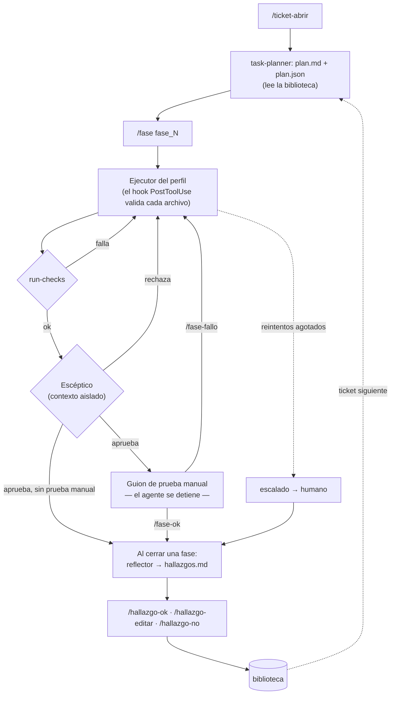

# IA Harness — versión *harness advance*

Harness de ingeniería para desarrollar con agentes de IA sobre proyectos reales de
Azzule. Corre de forma nativa en **Claude Code**, y su núcleo (CLI, contratos y
checks) es Python puro, así que también se puede usar con otros modelos (ver
[Usarlo con otro modelo](docs/tecnico.md#usarlo-con-otro-modelo-que-no-sea-claude)).

> **Agente = Modelo + Harness.** El modelo razona; el harness convierte ese
> razonamiento en trabajo verificable. Cada vez que el agente comete un error
> repetible, la corrección va al harness (una regla, un check, un hook), no solo
> al prompt.


> **Documentación técnica** (arquitectura, CLI, contratos, perfiles, desarrollo y
> pendientes): [docs/tecnico.md](docs/tecnico.md). Este README es la guía de uso.

---

## Contenido

- [Qué hace](#qué-hace)
- [Qué trae la versión harness advance](#qué-trae-la-versión-harness-advance)
- [El ciclo de un ticket](#el-ciclo-de-un-ticket)
- [Hallazgos y biblioteca de lecciones](#hallazgos-y-biblioteca-de-lecciones)
  - [Curar la biblioteca](#curar-la-biblioteca)
- [Instalación y despliegue](#instalación-y-despliegue)
- [Uso diario](#uso-diario)
  - [Los comandos de hallazgos, uno por uno](#los-comandos-de-hallazgos-uno-por-uno)
- [Cómo leer el reporte](#cómo-leer-el-reporte)
- [Errores frecuentes](#errores-frecuentes)

---

## Qué hace

Toma un requerimiento (un ticket) y lo lleva hasta código aprobado, en fases, con
verificación escalonada de menor a mayor costo:

| Nivel | Quién verifica | Costo | Qué atrapa |
|---|---|---|---|
| 1. Hook en vivo | `check_rules.py`, en cada archivo que el agente guarda | milisegundos | Reglas del stack: sintaxis prohibida, comentarios de auditoría, dependencias nuevas |
| 2. Checks de la fase | `cli.py run-checks` + checks estructurales del perfil | segundos | Lo que exige cruzar archivos, compilar o correr pruebas |
| 3. Escéptico | Subagente `skeptic`, con contexto aislado | caro | Afirmaciones sin evidencia, criterio de éxito no cumplido, regresiones |
| 4. Humano | El desarrollador, con un guion de prueba manual | el más caro | La verificación funcional de punta a punta |

Reglas que lo sostienen:

- **Los contadores y el estado los escribe solo el CLI**, nunca el modelo.
- **El agente escribe JSON y un script lo valida y lo rechaza** si no cumple el contrato.
- **La fase no se cierra sin la puerta humana**: el hook `Stop` impide terminar el
  turno con una fase a medio ciclo.
- **Los reintentos tienen límite**: al agotarse, la fase pasa a `escalado` y vuelve al humano.


## Qué trae la versión harness advance

La versión *harness advance* incorpora ideas de
[Harness²](https://github.com/google-research/harness2) (Google Research), adaptadas
para que **el humano esté en el ciclo**. Allá el aprendizaje es automático; aquí
una lección pasa por el desarrollador antes de afectar a los tickets siguientes.

| Novedad | Qué es |
|---|---|
| **`task-planner` v3** | Skill que planea el ticket en fases ancladas en el código. Emite `plan.md` para el humano y `plan.json` para el harness, y lee la biblioteca de lecciones |
| **Reflector** | Subagente de **solo lectura** que, al cerrar cada fase (aprobada o escalada), propone lecciones reutilizables |
| **Hallazgos con decisión humana** | Cada lección propuesta queda `propuesto` hasta que el desarrollador la aprueba, la edita o la rechaza |
| **Biblioteca** | Las lecciones aprobadas viven en `<proyecto>/.claude/biblioteca/` y se versionan con el proyecto. El planner las lee en el ticket siguiente |
| **"Dónde va cada corrección"** | Una escalera que dice qué pieza del harness corrige cada tipo de fallo (ver [docs/tecnico.md](docs/tecnico.md#dónde-va-cada-corrección)) |
| **Reincidencias y deuda** | El reflector marca cuando un error ya estaba en la biblioteca; el humano marca cuándo construyó la pieza que pedía una lección; `report` cruza ambas cosas |
| **Test de referencias** | Falla si un documento del harness nombra una skill, un agente, un subcomando o un comando que no existe |
| **Evidencia es dato** | El escéptico y el reflector no obedecen instrucciones escritas dentro del código o de los archivos que revisan |

Detalle del diseño: `docs/superpowers/plans/harness-advance.md` (origen y decisiones
DA1–DA9) y la spec, decisiones D10–D13 y secciones §6.6, §10 y §10.1.

## El ciclo de un ticket



Cada vuelta por el ejecutor es un **intento**. Un fallo de checks, del escéptico o
de la prueba manual se guarda en `historial_fallos` con su origen (`check`,
`esceptico` o `humano`), y el intento siguiente recibe el historial completo. Las
correcciones que pide el hook en vivo no cuentan como intento: son autocorrección.


## Hallazgos y biblioteca de lecciones

### Cómo nace un hallazgo

1. La fase se cierra (aprobada o escalada).
2. El **reflector** recibe, en contexto aislado, la fase del plan, el
   `historial_fallos`, el `checks.json` y el `veredicto.json` de cada intento, el
   resultado de la prueba manual y el `INDEX.md` de la biblioteca. No recibe la
   conversación del ejecutor.
3. Propone cero o más hallazgos. **No proponer nada es una respuesta válida.**
4. `cli.py record-hallazgos` valida la propuesta y escribe `hallazgos.json` y
   `hallazgos.md` en la carpeta de la fase. Todos quedan en estado `propuesto`.

Cada hallazgo tiene:

| Campo | Significado |
|---|---|
| `senal` | En qué situación aplica (la forma del caso, no los datos de este ticket) |
| `leccion` | Qué hacer, nombrando la pieza del harness |
| `evidencia` | Los intentos, checks u observaciones en que se apoya |
| `confianza` | `alta`, `media` o `baja` |
| `dimension` | `proceso` (cómo trabaja el agente) o `dominio` (lo que sabe alguien que domina el proyecto) |
| `componente` | Dónde va la corrección: `regla`, `check`, `skill`, `hook` o `agente` (ver [dónde va cada corrección](docs/tecnico.md#dónde-va-cada-corrección)) |
| `reincide` | Opcional. La referencia de una lección aprobada que ya debía evitar este error |


### Tu decisión

`hallazgos.md` muestra cada hallazgo con su referencia completa `TICKET/fase_N/hN`:

```text
/hallazgo-ok ISR-110722/fase_1/h1
/hallazgo-editar ISR-110722/fase_1/h2 "lección corregida"
/hallazgo-no ISR-110722/fase_1/h3 "motivo"
/hallazgo "una lección mía"        ← entra aprobada, con origen humano
```

- **Nada entra a la biblioteca sin tu decisión.**
- **Los pendientes no bloquean** la fase ni el ticket. `/ticket-abrir` y
  `cli.py hallazgos-pendientes` te los recuerdan.
- **Los rechazados se guardan con su motivo**, para que el reflector no los vuelva a proponer.
- Usa siempre la referencia completa para un hallazgo de otra fase u otro ticket.
  Un `h1` suelto solo vale para la fase activa.
- El detalle de cada comando, con ejemplos y errores, está en
  [Los comandos de hallazgos, uno por uno](#los-comandos-de-hallazgos-uno-por-uno).

### La biblioteca

```
<proyecto>/.claude/biblioteca/
├── INDEX.md                          derivado: se reconstruye desde las entradas
├── entradas/ISR-110722-fase_1-h1.md  lecciones aprobadas
├── rechazados/ISR-110722-fase_1-h3.md
├── retiradas/ISR-110722-fase_2-h1.md lecciones que salieron por una curación
└── curacion-rechazada.md             curaciones que rechazaste
```

- **Versiónala con el proyecto**: haz commit de `.claude/biblioteca/` después de
  aprobar hallazgos, para que el equipo la reciba.
- `deploy.ps1` nunca la pisa: copia el perfil sin borrar y ningún perfil trae
  una carpeta `biblioteca/` (lo vigila un test).
- Si `INDEX.md` queda en conflicto en un merge, corre
  `cli.py reconstruir-biblioteca`: el índice se genera de nuevo a partir de las entradas.
- **Para el planner, una lección es una hipótesis**: si la usa, la ancla como
  `por_confirmar` y la verifica en el código.


### Reincidencias y lecciones implementadas

Dos marcas cuentan qué pasa con una lección después de aprobarla:

- **Reincidencia.** Si en otra fase el agente repite un error que una lección aprobada
  ya debía evitar, el reflector lo propone con `reincide` apuntando a esa lección y
  `hallazgos.md` lo muestra como `reincide en <ref>`. Al aprobarlo con `/hallazgo-ok`
  o `/hallazgo-editar` **no nace una entrada nueva**: la original suma una línea
  `falló` con la fecha, el ticket y si la lección tenía pieza en ese momento. Si el
  reflector se equivocó, `--nueva` o `--reincide <ref>` lo corrigen (ver
  [los comandos](#los-comandos-de-hallazgos-uno-por-uno)). Rechazarlo funciona como siempre.
- **Implementada.** Cuando construyes la pieza que pedía la lección, `/hallazgo-hecho`
  la marca. Desde entonces una nueva falla cuenta como "falló estando implementada".

`INDEX.md` muestra las marcas junto a cada lección, por ejemplo
`(implementada 02-11-2026) (falló 2×)`. El planner y el reflector lo leen: una lección
que ya falló pesa más al planear, y el reflector sabe cuáles tienen pieza. El
[reporte](#cómo-leer-el-reporte) las cruza. Detalle de las líneas en
[docs/tecnico.md](docs/tecnico.md#líneas-de-una-entrada-de-la-biblioteca).


### Curar la biblioteca

La biblioteca solo crece con cada fase, y el planner la lee entera en cada ticket.
Con el tiempo se juntan lecciones que dicen lo mismo, otras que contradicen una regla
del perfil y otras que hablan de código que ya no existe. `/biblioteca-curar` corre
un **curador** (solo lectura, como el reflector) que propone dos tipos de acción:

- **Fusionar** lecciones que dicen lo mismo en una sola, que conserva las fallas de
  todas.
- **Retirar** una lección que ya no vale, con el motivo.

Cada acción la decides tú con `/curacion-ok cN`, `/curacion-editar cN ...` o
`/curacion-no cN "<motivo>"`. **Nada se borra:** lo retirado pasa a `retiradas/` con
su motivo y sus fallas, `INDEX.md` lo lista en "Retiradas — no aplicar", y una
referencia vieja a una lección fusionada te dice cuál usar. Tus rechazos quedan en
`curacion-rechazada.md`, que se versiona, para que el curador no los vuelva a
proponer en ningún clon.

**Cuándo correrla:** cuando el [reporte](#cómo-leer-el-reporte) lo sugiere en su
sección Curación, o cuando la biblioteca creció varios tickets sin revisarse. No hace
falta un ticket abierto, pero una lección que ancla el ticket en curso no se toca hasta
que todas sus fases estén aprobadas.

**Cómo decidir:** las señales (`cli.py senales-biblioteca`) son pistas, no motivos.
`usos` cuenta los planes de **tu** clon, así que "sin uso" no basta para retirar; una
ruta ausente puede ser un archivo generado que git no rastrea, o algo que no es una
ruta (un endpoint).


## Instalación y despliegue

Requisitos: Windows con PowerShell 5.1, Python 3.12 (solo stdlib), Git y Claude Code.

1. **Desplegar** el harness genérico y el perfil del proyecto:

   ```powershell
   .\deploy.ps1 -Proyecto "C:\ruta\al\proyecto" -Perfil <perfil>
   ```

   Copia `harness/{hooks,agents,skills,commands}` a `~/.claude/` y
   `profiles/<perfil>/` a `<proyecto>/.claude/`. También agrega `.harness/` al
   `.gitignore` del proyecto.

   Además registra los dos hooks (`check_rules.py` y `gate_phase.py`) en
   `~/.claude/settings.json` y dice qué hizo con cada uno. Solo agrega lo que falta: no
   toca tus otros hooks ni el resto del archivo, y si lo modifica deja antes un respaldo
   `settings.json.bak-dd-mm-aaaa-HHMMSS`. Si `settings.json` no es un JSON válido, no lo
   toca y el despliegue falla.

   Con `-SinHooks` no toca `settings.json`: imprime el bloque con tus rutas para que lo
   fusiones a mano dentro del objeto `hooks`.

2. **Abrir una sesión nueva** de Claude Code en el proyecto. Las sesiones que ya
   estaban abiertas no cargan los agentes ni los comandos nuevos.

Perfiles incluidos en este repo: `reviewsystemgfs` (VB.NET, Web Forms, .NET 3.5,
sin build desde línea de comandos; checks estructurales `designer_sync`, `sp_params` y
`xhtml_selfclose` en lugar del compilador) y `editornotificaciones` (.NET + Vue 2, con
build, pruebas y un check de contraste WCAG).

`sp_params` necesita saber dónde están los SPs: `sp_params.carpetas_sp` en el
`rules.json` del perfil. Viene con `../../ProjectSQL/MSSQL/PrimusGFS/Procedimiento`
(relativa a la raíz del proyecto) y `ReviewSystem/Sps` de respaldo; si tus carpetas
están en otro lado, cambia esa lista. Una carpeta que no existe se avisa y se omite.


## Uso diario

| Comando | Cuándo |
|---|---|
| `/ticket-abrir <requerimiento o ruta .md>` | Empezar un ticket: pide número, desarrollador y fecha, y genera el plan |
| `/fase fase_N` | Correr el ciclo completo de una fase; termina en el guion de prueba manual |
| `/fase-pausa ["<motivo>"]` | Pausar la fase activa para conversar de otra cosa o cerrar el día. Se retoma con `/fase fase_N` sin gastar intento. Si entretanto abriste otro ticket, reábrelo primero con el mismo id y los datos de su `ticket_context.json`, sin replanificar |
| `/fase-ok` | La prueba manual pasó. Cierra la fase y llama al reflector |
| `/fase-fallo <paso> "<qué pasó>"` | La prueba manual falló en ese paso; arranca el intento siguiente |
| `/hallazgo-ok <ref>` | Aprobar un hallazgo |
| `/hallazgo-editar <ref> "<lección>"` | Corregir y aprobar un hallazgo |
| `/hallazgo-no <ref> "<motivo>"` | Rechazar un hallazgo |
| `/hallazgo "<lección>"` | Agregar una lección propia (entra aprobada) |
| `/hallazgo-hecho <ref> "<nota>"` | Avisar que ya construiste la pieza que pedía una lección aprobada |
| `/biblioteca-curar` | Correr el curador sobre la biblioteca (ver [Curar la biblioteca](#curar-la-biblioteca)) |
| `/curacion-ok <cN>` | Aplicar una acción de curación |
| `/curacion-editar <cN> [--texto] [--senal] [--quitar <ref>] [--motivo]` | Corregir y aplicar una acción de curación |
| `/curacion-no <cN> "<motivo>"` | Rechazar una acción de curación |

El orquestador es la skill `ticket-loop`, que los comandos invocan. Si la sesión se
corta, se retoma desde el estado en `.harness/`: el CLI y el hook `Stop` saben en qué
estado quedó cada fase.

Para emergencias, si el hook `Stop` te atrapa y no hay otra salida, ábrelo apagado:
`$env:HARNESS_STOP="off"; claude`. Solo se lee al abrir la sesión, y apaga el hook
por completo mientras dure.

### Los comandos de hallazgos, uno por uno

Los cinco comandos de hallazgos son atajos de `cli.py`. El agente solo extrae los argumentos y
corre el CLI, que es el único que escribe estado: `hallazgos.json`, `hallazgos.md` y
la biblioteca. Si falta un argumento obligatorio, el agente lo pide antes de correr
nada. Si el CLI falla, muestra el error tal cual.

**Cómo nombrar un hallazgo (`<ref>`).** Usa la referencia completa `TICKET/fase_N/hN`,
tal como la imprimen `hallazgos.md` y `cli.py hallazgos-pendientes`. Un id suelto
(`h1`) solo vale para la fase activa de `current.json`. El agente nunca completa la
referencia por su cuenta.

Al cerrar una fase, `hallazgos.md` termina con las tres respuestas posibles de cada
hallazgo propuesto, listas para copiar:

```text
Responder por cada hallazgo propuesto:
- Aprobar → `/hallazgo-ok ISR-110722/fase_1/h1`
- Corregir y aprobar → `/hallazgo-editar ISR-110722/fase_1/h1 "<lección corregida>"`
- Rechazar → `/hallazgo-no ISR-110722/fase_1/h1 "<motivo>"`
```

#### `/hallazgo-ok <ref>`

Aprueba la lección tal como la propuso el reflector.

- **Ejemplo:** `/hallazgo-ok ISR-110722/fase_1/h1`
- **Corre:** `cli.py resolver-hallazgo --decision ok --id ISR-110722/fase_1/h1`
- **Efecto:**
  - El hallazgo pasa a `aprobado`.
  - Se escribe `.claude/biblioteca/entradas/ISR-110722-fase_1-h1.md`.
  - Se reconstruye `INDEX.md`.
- **Salida:** `Hallazgo ISR-110722/fase_1/h1 aprobado: <ruta de la entrada>`
- **Si es una reincidencia** (el hallazgo trae `reincide en <ref>` en `hallazgos.md`):
  no se crea entrada; se agrega una línea `falló` a la lección original. La salida es
  `Hallazgo <ref> aprobado como reincidencia de <ref original>: <ruta de la entrada original>`.
- **Si el reflector se equivocó**, dos opciones que se pasan tal cual al CLI:
  - `--nueva`: no es reincidencia; ignora la marca y crea una entrada nueva.
    Ejemplo: `/hallazgo-ok ISR-110722/fase_1/h4 --nueva`
  - `--reincide <ref>`: sí es reincidencia, de esa otra lección (la haya marcado o no
    el reflector). Ejemplo: `/hallazgo-ok ISR-110722/fase_1/h4 --reincide ISR-110501/fase_2/h1`
  - Solo valen al aprobar, no juntas, y la lección tiene que estar **aprobada**.

#### `/hallazgo-editar <ref> "<lección corregida>"`

Aprueba el hallazgo con tu propia redacción. Úsalo cuando la señal es buena pero la
lección está mal dicha, es demasiado amplia o es demasiado específica.

- **Ejemplo:**
  `/hallazgo-editar ISR-110722/fase_1/h2 "Antes de cambiar la firma de un método, buscar todos sus llamadores"`
- **Corre:** `cli.py resolver-hallazgo --decision editar --id ISR-110722/fase_1/h2 --texto "..."`
- **Efecto:**
  - El hallazgo pasa a `aprobado` con tu texto en `lección`.
  - La propuesta del reflector se conserva en `lección original`, así queda visible
    qué corregiste.
  - La entrada va a `entradas/`.
- **Opciones:** admite `--nueva` y `--reincide <ref>`, igual que `/hallazgo-ok`.

#### `/hallazgo-no <ref> "<motivo>"`

Rechaza el hallazgo. El motivo es obligatorio porque el reflector lo lee, y así no
vuelve a proponer lo mismo.

- **Ejemplo:**
  `/hallazgo-no ISR-110722/fase_1/h3 "Fue un caso puntual del ticket, no un patrón"`
- **Corre:** `cli.py resolver-hallazgo --decision no --id ISR-110722/fase_1/h3 --motivo "..."`
- **Efecto:**
  - El hallazgo pasa a `rechazado`.
  - La entrada va a `rechazados/`.
  - Aparece en `INDEX.md` bajo "Rechazadas — no volver a proponer".

#### `/hallazgo "<lección>"`

Agrega una lección que viste tú y que ningún agente vio. Entra **ya aprobada**, con
`origen: humano`, y se cuelga de la fase activa con el siguiente id libre (`hN`).

- **Ejemplo:** `/hallazgo "En este proyecto los textos visibles van en el archivo de recursos, nunca en el código"`
- **Opcional:** indica la dimensión (`proceso` o `dominio`) y la pieza del harness que
  la corrige (`regla`, `check`, `skill`, `hook` o `agente`), y el agente los pasa al
  CLI. Por ejemplo:
  `/hallazgo "..." — dimensión dominio, componente regla`
- **Corre:** `cli.py hallazgo --texto "..." [--dimension ...] [--componente ...] [--ticket ... --fase ...]`
- **Entre tickets** (sin fase activa), di de qué fase es:
  `/hallazgo "..." — ticket ISR-110722, fase fase_2`, y el agente pasa
  `--ticket ISR-110722 --fase fase_2`. La fase tiene que haberse abierto alguna vez.

#### `/hallazgo-hecho <ref> "<nota>"`

Avisa que ya construiste la pieza del harness que pedía una lección aprobada: la
regla, el check, la skill, el hook o el texto del agente. Úsalo después de hacer la
pieza, no antes: el reporte distingue las lecciones con pieza de las que siguen siendo
deuda.

- **Ejemplo:**
  `/hallazgo-hecho ISR-110722/fase_1/h2 "regla no_firma_sin_llamadores en rules.json, commit 4f2a9c1"`
- **Corre:** `cli.py hallazgo-hecho --id ISR-110722/fase_1/h2 --nota "..."`
- **Efecto:** escribe en la entrada `- **implementada**: <fecha> · <nota>` y `INDEX.md`
  pasa a mostrar `(implementada <fecha>)`. Las líneas `falló` anteriores se conservan.
- **Salida:** `Lección <ref> implementada: <fecha> · <nota>`. Si ya estaba marcada, una
  segunda línea dice la marca que reemplazó.
- **Requisitos:** la referencia completa (un `h1` suelto no vale), una nota (di qué
  hiciste: un commit, un archivo) y una lección **aprobada**.

Para ver todo lo que queda por decidir, en todos los tickets:

```powershell
python "$HOME\.claude\hooks\cli.py" hallazgos-pendientes
```

Después de aprobar o rechazar, haz commit de `.claude/biblioteca/` en el proyecto.

## Cómo leer el reporte

```powershell
python "$HOME\.claude\hooks\cli.py" report [--project <ruta>] [--json]
```

Solo lee: no escribe nada en el proyecto. Mira `.harness/tickets/` y
`.claude/biblioteca/`. Con `--json` imprime los mismos datos crudos, para otra
herramienta. Un proyecto sin datos no da error: cada sección dice `Sin datos todavía.`
Un archivo ilegible o mal formado no detiene el reporte: se nombra al final, en
"Archivos que no se pudieron leer", y sigue.

Las secciones van de lo que más dice sobre si el harness aprende a lo que menos.
Léelas en ese orden.

**Resumen.** Los contadores: tickets, fases, fases escaladas, lecciones aprobadas,
implementadas, las que fallaron estando implementadas y las que volvieron sin pieza.
Ojo: *volvieron sin pieza* es **histórico**. Cuenta las veces que una lección volvió a
fallar cuando no tenía pieza (una por reincidencia), aunque luego hayas construido la
pieza o la lección se haya retirado o fusionado en una curación, así que puede ser
mayor que lo que lista la Deuda. Curar no lo baja.

**Fallaron estando implementadas.** Cada lección que volvió a fallar *después* de
marcarla con `/hallazgo-hecho`, con su señal, su pieza y, por cada falla, la fecha, el
ticket y lo que debió hacerse. Junto a cada lección se muestra su marca `implementada`
actual (fecha y nota): una falla anterior a una marca nueva se lee como historia.
Es la sección más grave: **la pieza no funciona**.
Qué hacer:

1. Abre la lección y la falla, y averigua por qué la pieza no la atrapó: ¿el patrón
   no cubre este caso? ¿el check no corre en esta fase? ¿la instrucción se ignora?
2. Corrígela o súbela a una pieza más fuerte (de `skill` o `agente` a `check`, de
   `check` a `hook`; ver [dónde va cada corrección](docs/tecnico.md#dónde-va-cada-corrección)).
3. Cuando la pieza nueva esté, vuelve a correr `/hallazgo-hecho` con una nota nueva: la
   marca anterior se reemplaza y las fallas quedan en el historial.

**Deuda.** Lecciones aprobadas sin `implementada`, agrupadas por pieza
(`regla`, `check`, `skill`, `hook`, `agente`; las lecciones propias sin pieza, en su
grupo). Dentro de cada grupo van primero las que **volvieron sin pieza**, con
`costó otra vez N×` y, por cada vez, fecha, ticket y lo que debió hacerse. Ese N× es
tu orden de trabajo: **construye primero la pieza de la lección que más veces costó**.
Al terminar una, márcala con `/hallazgo-hecho`: sale de la deuda.

**Curación.** Las lecciones que ningún plan de este clon ancló, las que mencionan
rutas que git ya no rastrea, cuántas acciones de curación esperan tu decisión, cuándo
fue la última curación y cuántas lecciones se retiraron. Si hay alguna señal o
pendiente, sugiere `/biblioteca-curar`. Son pistas: ver
[Curar la biblioteca](#curar-la-biblioteca).

**Hallazgos.** Cuántos se aprobaron tal cual, cuántos con edición, cuántos eran
reincidencias y cuántos son tuyos; los **propuestos sin resolver**, con su referencia
(decídelos con `/hallazgo-ok`, `/hallazgo-editar` o `/hallazgo-no`), y los rechazados
con su motivo. Muchos editados sugieren que el reflector redacta mal; muchos
rechazados, que propone lo que no es un patrón.

**Fases.** Intentos por fase (`usados/máximo` y estado), las fases escaladas, el origen
de los fallos (`check`, `esceptico`, `humano`), las reglas más violadas y las fases
que el escéptico rechazó en dos o más intentos, con sus razones. Una fase rechazada
varias veces por razones parecidas es candidata a un check determinista. Una regla muy
violada puede estar mal escrita o no llegarle a quien la necesita.

**Archivos que no se pudieron leer.** Solo aparece si hubo alguno: JSON inválido,
bytes que no se pueden decodificar, un `hallazgos.json` fuera de contrato. El reporte
cuenta lo demás; arregla o borra esos archivos para que entren.

Ejemplo, con una lección que volvió a costar sin pieza:

```text
Deuda
  check
    ISR-110722/fase_1/h2 — Cambio de firma sin buscar llamadores — costó otra vez 2×
      02-11-2026 en ISR-111003/fase_2/h1: Buscar los llamadores antes de cambiar la firma
      05-11-2026 en ISR-111240/fase_1/h3: Buscar los llamadores antes de cambiar la firma
```

## Errores frecuentes

| Mensaje del CLI | Qué pasó |
|---|---|
| `el hallazgo '<ref>' no existe; ids válidos en …: h1, h2` | El id no está en esa fase. El mensaje lista los ids válidos |
| `el hallazgo <ref> ya está 'aprobado'` (o `'rechazado'`) | Ya se decidió. Los comandos no deshacen una decisión |
| `la fase '…' del ticket '…' no tiene hallazgos` | Esa fase todavía no tiene reflexión registrada |
| `no se sabe qué fase resolver: usa la referencia completa …` | Diste un `h1` suelto y no hay fase activa |
| `'…' no es un hallazgo: usa el id (h1) o la referencia completa …` | La referencia está mal escrita |
| `rechazar un hallazgo exige --motivo …` | `/hallazgo-no` sin motivo |
| `editar un hallazgo exige --texto …` | `/hallazgo-editar` sin la lección corregida |
| `no hay fase activa: corre 'open-fase'` | `/hallazgo` fuera de una fase |
| `--nueva y --reincide se excluyen: elige una` | Pasaste las dos a `/hallazgo-ok` o `/hallazgo-editar` |
| `--nueva y --reincide solo valen al aprobar …` | Las pasaste con `/hallazgo-no` |
| `el hallazgo <ref> reincide en …` | La lección a la que reincide no está aprobada (rechazada, sin decidir o mal escrita). No se escribió nada |
| `--reincide '…' no tiene la forma TICKET/fase_N/hN` | La referencia está mal escrita |
| `--id '…' no tiene la forma TICKET/fase_N/hN: este comando solo acepta la referencia completa` | `/hallazgo-hecho` con un id suelto |
| `--nota no puede estar vacía …` | `/hallazgo-hecho` sin decir qué se hizo |
| `no se puede marcar … ` | Solo se marca una lección aprobada; esa no existe o no está aprobada |
